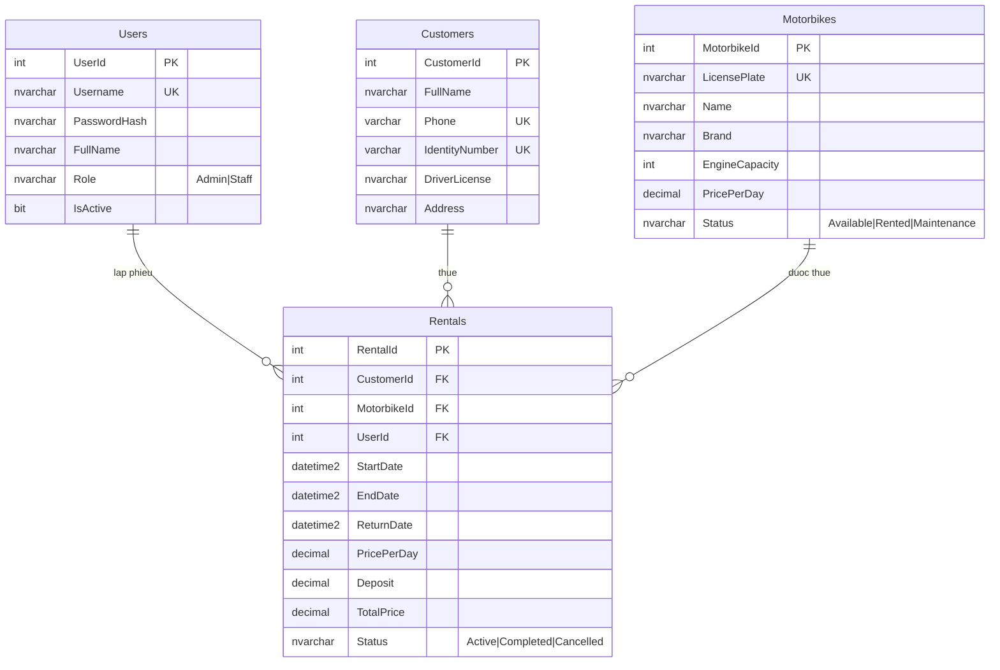

# Đề tài: Quản lý cửa hàng cho thuê xe máy — PRN232

## 1. Mô tả hệ thống
Hệ thống hỗ trợ cửa hàng cho thuê xe máy quản lý đội xe, khách hàng và các phiếu thuê/trả xe, tính tiền và thống kê doanh thu.
Gồm 2 phần: **Web API Services** (ASP.NET Core Web API + EF Core + SQL Server) và **Web App MVC** đóng vai trò Client gọi API.

## 2. Tác nhân (Actors)
| Tác nhân | Mô tả | Quyền |
|---|---|---|
| Admin (Chủ cửa hàng/Quản lý) | Quản trị toàn hệ thống | Toàn quyền: xe, khách hàng, phiếu thuê, tài khoản, báo cáo doanh thu |
| Staff (Nhân viên cho thuê) | Làm việc tại quầy | Xem xe; quản lý khách hàng; tạo phiếu thuê, trả xe, hủy phiếu |
| Client Web App | Ứng dụng MVC | Gọi API bằng JWT của người dùng đã đăng nhập |
| Hệ thống/SQL Server | Lưu trữ | Ràng buộc dữ liệu (CHECK, UNIQUE, FK) |

## 3. Chức năng nghiệp vụ & Endpoints
| Nhóm | Endpoint | Mô tả | Quyền |
|---|---|---|---|
| Auth | `POST /api/auth/login` | Đăng nhập, trả JWT | Công khai |
| Xe máy | `GET /api/motorbikes` (OData) | Danh sách, lọc/sắp xếp/chọn cột | Admin, Staff |
| | `GET /api/motorbikes/{id}` | Chi tiết xe | Admin, Staff |
| | `POST /api/motorbikes` | Thêm xe | Admin |
| | `PUT /api/motorbikes/{id}` | Sửa xe | Admin |
| | `DELETE /api/motorbikes/{id}` | Xóa xe (chặn nếu đã có lịch sử thuê) | Admin |
| Khách hàng | `GET /api/customers?q=` | Tìm kiếm khách hàng | Admin, Staff |
| | `GET/POST/PUT/DELETE /api/customers[/{id}]` | CRUD khách hàng | Admin, Staff |
| Phiếu thuê | `GET /api/rentals?status=` | Danh sách phiếu thuê | Admin, Staff |
| | `GET /api/rentals/{id}` | Chi tiết phiếu | Admin, Staff |
| | `POST /api/rentals` | Tạo phiếu (kiểm tra xe sẵn sàng, tính tiền, xe → Rented) | Admin, Staff |
| | `POST /api/rentals/{id}/return` | Trả xe, tính lại tiền nếu trả trễ, xe → Available | Admin, Staff |
| | `POST /api/rentals/{id}/cancel` | Hủy phiếu đang thuê | Admin, Staff |
| Tài khoản | `GET/POST /api/users`, `POST /api/users/{id}/toggle` | Xem, tạo, khóa/mở khóa | Admin |
| Báo cáo | `GET /api/reports/summary` | Thống kê xe, doanh thu tháng, 6 tháng gần nhất | Admin |

**Quy tắc nghiệp vụ**
- Chỉ xe `Available` mới được cho thuê; tạo phiếu → xe `Rented`; trả/hủy → `Available`.
- Tiền thuê = giá/ngày × số ngày (làm tròn lên, tối thiểu 1 ngày). Trả trễ tính theo thời điểm trả thực tế.
- Không xóa xe/khách hàng đã có lịch sử thuê. Biển số, SĐT, CCCD là duy nhất.
- Thời gian thuê tối đa 90 ngày; ngày trả phải sau ngày thuê.

## 4. Thiết kế CSDL

Ràng buộc trong CSDL: PK/FK, UNIQUE (Username, Phone, IdentityNumber, LicensePlate), CHECK (Role, Status, Phone, CCCD, giá > 0, dung tích 50–1000, `EndDate > StartDate`, Deposit ≥ 0), DEFAULT.

## 5. Đối chiếu yêu cầu đề bài
| Yêu cầu | Cách đáp ứng / vị trí trong code |
|---|---|
| 1.1–1.2 Mô tả tác nhân, nghiệp vụ endpoints | Mục 2, 3 của tài liệu này |
| 1.3 ASP.NET Web API | Dự án `MotorRental.Api` |
| 1.4 SQL Server + EF Core | `Database/MotorRentalDB.sql`, `Data/MotorRentalContext.cs`, `Models/Entities.cs` |
| 1.5 Ràng buộc trong code và CSDL | CHECK/UNIQUE/FK trong SQL; kiểm tra trùng/trạng thái trong controllers |
| 1.6 DTO cho CRUD | `DTOs/Dtos.cs` (MotorbikeDTO, MotorbikeSaveDTO, CustomerSaveDTO, CreateRentalDTO, ...) |
| 1.7 Validation | DataAnnotations + `IValidatableObject` (`CreateRentalDTO`), `[ApiController]` tự trả 400 |
| 1.8 Routing | `[Route("api/[controller]")]`, `{id:int}`, `{id}/return`, `{id}/cancel`, `summary` |
| 1.9 OData | `GET api/motorbikes` với `[EnableQuery]` (`$filter/$orderby/$select/$top/$skip/$count`) |
| 1.10 JWT + Role-based | `Services/JwtService.cs`, `Program.cs`, `[Authorize(Roles = "...")]` |
| 2.1–2.2 Mô tả tác nhân/nghiệp vụ hệ thống | Mục 2, 3 |
| 2.3 MVC | Dự án `MotorRental.Web` (Controllers/Views/Models) |
| 2.4 HTML5, CSS3, Bootstrap5 (responsive) | `Views/Shared/_Layout.cshtml`, các view dùng grid/table-responsive |
| 2.5 TagHelper, PartialView | `TagHelpers/AppTagHelpers.cs` (`<status-badge>`, `<money>`), `asp-*`; partial `_Navbar`, `_Alerts`, `_Form` |
| 2.6 Dùng Web API tương tác dữ liệu | `Services/ApiClient.cs` (HttpClient + JWT) |
| 2.7 Identity phân quyền | Cookie Authentication + ClaimsPrincipal (Role) + `[Authorize(Roles)]` + ẩn/hiện menu theo role |
| 2.8 Kiểm tra ràng buộc trong code | DataAnnotations trong `ViewModels.cs`, jQuery Validation, hiển thị lỗi từ API |

## 6. Phân công nhóm (điền tên thành viên)
| Thành viên | Nhiệm vụ đề xuất |
|---|---|
| TV1 | CSDL + EF Core + Models + seed dữ liệu; Auth/JWT; Users |
| TV2 | API Motorbikes (OData) + Customers + DTO/Validation |
| TV3 | API Rentals + Reports; kiểm thử Swagger |
| TV4 | Web MVC: Layout, Account, Home dashboard, Motorbikes |
| TV5 | Web MVC: Customers, Rentals, Users; báo cáo + ảnh giao diện |

## 7. Hình ảnh giao diện (chụp khi chạy)
Đăng nhập · Tổng quan (Admin) · Danh sách xe + lọc OData · Thêm/Sửa xe · Khách hàng · Tạo phiếu thuê · Trả xe · Tài khoản · Swagger.
