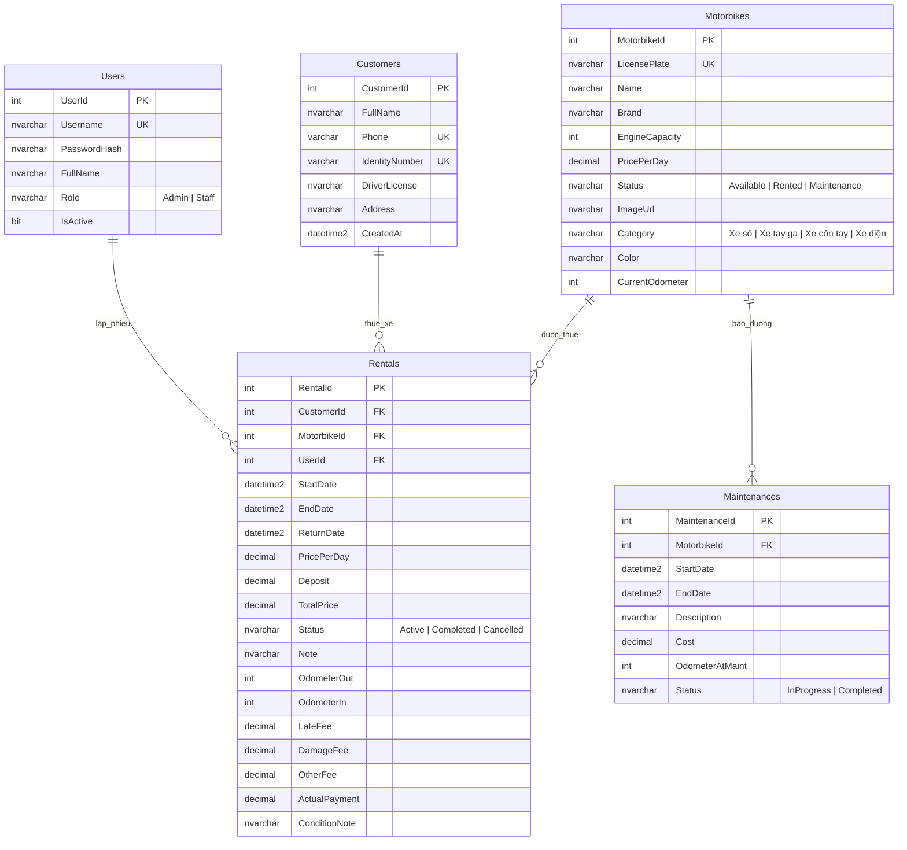

# BÁO CÁO PHÂN TÍCH & THIẾT KẾ HỆ THỐNG
## ĐỀ TÀI: QUẢN LÝ CỬA HÀNG CHO THUÊ XE MÁY (PRN232 - ASP.NET Core Web API & MVC)

---

## 1. TỔNG QUAN HỆ THỐNG & ĐẶC TẢ NGHIỆP VỤ

### 1.1. Mục tiêu
Xây dựng giải pháp phần mềm quản lý toàn diện cho chuỗi/cửa hàng cho thuê xe máy du lịch & đi lại hàng ngày, bao gồm 2 thành phần độc lập:
1. **Web API Services (`MotorRental.Api`)**: Xây dựng bằng ASP.NET Core Web API (.NET 8) + EF Core + SQL Server, xác thực và phân quyền bằng JWT Token, hỗ trợ truy vấn nâng cao với OData.
2. **Web App Client (`MotorRental.Web`)**: Xây dựng theo mô hình ASP.NET Core MVC đóng vai trò Client độc lập, giao tiếp với Web API qua `HttpClient` kèm JWT Bearer Token, giao diện hiện đại chuẩn SaaS Dashboard với HTML5/CSS3, Bootstrap 5, Chart.js và hỗ trợ xuất biên bản bàn giao song ngữ kèm mã thanh toán VietQR.

### 1.2. Các quy tắc nghiệp vụ cốt lõi (Business Rules)
- **Quy trình Quản lý Đội xe (Fleet Management)**:
  - Phân loại xe: Xe số (Manual), Xe tay ga (Scooter), Xe côn tay (Clutch), Xe điện (EV).
  - Trạng thái xe máy:
    + `Available` (Sẵn sàng): Xe đang trống tại showroom, đầy đủ giấy tờ và an toàn kỹ thuật, sẵn sàng bàn giao cho khách thuê.
    + `Rented` (Đang thuê): Xe đang được khách hàng sử dụng theo một hợp đồng đang có hiệu lực.
    + `Maintenance` (Bảo dưỡng): Xe đang ở trong xưởng sửa chữa, thay nhớt định kỳ hoặc khắc phục sự cố, tạm khóa không cho thuê.
  - Mỗi xe có biển kiểm soát duy nhất (Unique License Plate) và ghi nhận chỉ số đồng hồ công-tơ-mét (ODO).
- **Quy trình Bàn giao xe (Check-in / Rental)**:
  - Chỉ các xe ở trạng thái `Available` mới được phép lập hợp đồng cho thuê.
  - Khi lập phiếu thành công: Xe tự động đổi trạng thái sang `Rented`.
  - Ghi nhận chỉ số ODO lúc bàn giao (`OdometerOut`), vạch xăng, và checklist phụ kiện (02 mũ bảo hiểm, áo mưa, giấy tờ xe công chứng).
  - Khách hàng đặt cọc một khoản tiền bảo đảm (`Deposit`).
  - Tiền thuê tạm tính = Đơn giá ngày × Số ngày thuê (làm tròn lên theo ngày, tối thiểu 1 ngày).
- **Quy trình Nhận trả xe & Quyết toán (Check-out / Return)**:
  - Ghi nhận số ODO lúc trả (`OdometerIn`), tính quãng đường đã di chuyển và cập nhật lại ODO hiện tại của xe.
  - Tự động kiểm tra thời gian trả xe thực tế: Nếu trả trễ so với hạn hợp đồng, tính phụ phí trễ hạn (`LateFee`).
  - Kiểm tra hư hại/trầy xước hoặc thiếu phụ kiện: Tính phí hư hỏng (`DamageFee`).
  - Phụ thu khác (xăng cộ, rửa xe nếu quá bẩn) (`OtherFee`).
  - Quyết toán tài chính:
    $$\text{Tổng hóa đơn} = \text{Tiền thuê gốc} + \text{Phụ phí trễ hạn} + \text{Phí hư hại} + \text{Phụ phí khác}$$
    $$\text{Khách thực trả / Cửa hàng hoàn cọc} = \text{Tổng hóa đơn} - \text{Tiền cọc}$$
  - Sau khi hoàn tất: Xe tự động chuyển về trạng thái `Available`.
- **Quy trình Gia hạn hợp đồng (Extend Rental)**:
  - Cho phép gia hạn ngày kết thúc khi khách gọi điện xin thuê thêm mà không cần hủy tạo lại phiếu.
- **Quy trình Bảo dưỡng & Sửa chữa (`Maintenances`)**:
  - Ghi nhận lịch thay dầu nhớt, bảo trì săm lốp, phanh, nhông xích định kỳ theo số ODO.
  - Khi đưa xe vào xưởng bảo dưỡng, xe tự động chuyển trạng thái `Maintenance`. Khi hoàn tất, xe chuyển về `Available`.
  - Hạch toán toàn bộ chi phí bảo dưỡng vào báo cáo tài chính để tính ra **Lợi nhuận thuần = Doanh thu - Chi phí bảo trì**.

---

## 2. CÁC TÁC NHÂN HỆ THỐNG (ACTORS)

| Tác nhân | Mô tả & Trách nhiệm | Quyền hạn trong hệ thống |
|---|---|---|
| **Admin (Quản trị viên / Chủ cửa hàng)** | Toàn quyền kiểm soát và điều hành hoạt động kinh doanh | - Quản lý danh mục xe máy (Thêm, sửa, xóa, cấu hình giá, tải ảnh). - Quản lý tài khoản nhân viên (Tạo mới, khóa/mở khóa tài khoản). - Xem báo cáo tài chính, biểu đồ doanh thu 6 tháng, tỷ lệ lấp đầy đội xe, chi phí bảo dưỡng. - Quản lý và xóa hồ sơ bảo dưỡng xe. |
| **Staff (Nhân viên cho thuê / Bàn giao xe)** | Trực tiếp làm việc tại quầy giao dịch và showroom | - Tra cứu đội xe máy, tìm kiếm lọc xe qua OData. - Đăng ký và cập nhật hồ sơ khách hàng (CCCD, SĐT, GPLX). - Lập hợp đồng thuê xe máy, ghi nhận cọc và phụ kiện bàn giao. - Nhận trả xe, nghiệm thu hiện trạng, tính phụ phí và quyết toán hoàn cọc. - Gia hạn hợp đồng thuê, hủy phiếu thuê chưa bắt đầu. - Lập phiếu đưa xe vào bảo dưỡng định kỳ và xác nhận hoàn tất bảo dưỡng. - In ấn hợp đồng cho thuê song ngữ có mã thanh toán VietQR. |
| **Hệ thống Web API & Database** | Lưu trữ, bảo mật và cung cấp dịch vụ dữ liệu | - Xác thực JWT Bearer, phân quyền Role-based Access Control (RBAC). - Đảm bảo toàn vẹn dữ liệu qua CHECK, UNIQUE, FOREIGN KEY constraints. - Cung cấp endpoint OData cho phép filter, orderby, select dữ liệu linh hoạt. |

---

## 3. THIẾT KẾ CƠ SỞ DỮ LIỆU (ERD)

---

## 4. DANH MỤC ENDPOINTS WEB API

| Nhóm chức năng | Phương thức & URL | Mô tả chức năng | Quyền hạn |
|---|---|---|---|
| **Auth** | `POST /api/auth/login` | Đăng nhập tài khoản, cấp phát mã JWT Bearer | Public |
| **Motorbikes** | `GET /api/motorbikes` | Danh sách xe máy (Hỗ trợ OData `$filter, $orderby, $select, $top, $skip`) | Admin, Staff |
| | `GET /api/motorbikes/{id}` | Lấy chi tiết xe máy | Admin, Staff |
| | `POST /api/motorbikes` | Thêm phương tiện mới (Ảnh, loại xe, màu sắc, ODO) | Admin |
| | `PUT /api/motorbikes/{id}` | Cập nhật thông tin xe máy | Admin |
| | `DELETE /api/motorbikes/{id}` | Xóa xe máy (Chặn xóa nếu xe đã từng có lịch sử thuê) | Admin |
| **Customers** | `GET /api/customers?q=` | Tra cứu danh sách khách hàng | Admin, Staff |
| | `GET /api/customers/{id}` | Lấy chi tiết khách hàng | Admin, Staff |
| | `POST /api/customers` | Thêm mới khách hàng (Validate SĐT, CCCD) | Admin, Staff |
| | `PUT /api/customers/{id}` | Chỉnh sửa thông tin khách hàng | Admin, Staff |
| | `DELETE /api/customers/{id}` | Xóa khách hàng (Chặn xóa nếu đã có hợp đồng thuê) | Admin, Staff |
| **Rentals** | `GET /api/rentals?status=&q=&overdueOnly=` | Danh sách phiếu thuê xe, lọc xe quá hạn | Admin, Staff |
| | `GET /api/rentals/{id}` | Chi tiết 1 phiếu thuê | Admin, Staff |
| | `GET /api/rentals/{id}/detail` | Dữ liệu chi tiết phục vụ in hợp đồng & biên nhận | Admin, Staff |
| | `POST /api/rentals` | Lập hợp đồng cho thuê (Xe chuyển sang `Rented`) | Admin, Staff |
| | `POST /api/rentals/{id}/return` | Nhận trả xe, quyết toán phụ phí (Xe chuyển `Available`) | Admin, Staff |
| | `POST /api/rentals/{id}/extend` | Gia hạn ngày trả hợp đồng thuê | Admin, Staff |
| | `POST /api/rentals/{id}/cancel` | Hủy phiếu thuê (Xe chuyển về `Available`) | Admin, Staff |
| **Maintenances**| `GET /api/maintenances?status=` | Danh sách lịch sử bảo dưỡng và sửa chữa | Admin, Staff |
| | `POST /api/maintenances` | Lập phiếu bảo dưỡng (Xe chuyển sang `Maintenance`) | Admin, Staff |
| | `POST /api/maintenances/{id}/finish`| Hoàn tất bảo dưỡng (Xe tự động chuyển `Available`) | Admin, Staff |
| | `DELETE /api/maintenances/{id}` | Xóa hồ sơ bảo dưỡng | Admin |
| **Users** | `GET /api/users` | Danh sách tài khoản nhân viên | Admin |
| | `POST /api/users` | Tạo mới tài khoản (Băm mật khẩu PBKDF2) | Admin |
| | `POST /api/users/{id}/toggle` | Khóa hoặc kích hoạt lại tài khoản | Admin |
| **Reports** | `GET /api/reports/summary` | Thống kê doanh thu, tỷ lệ đội xe, chi phí bảo trì, biểu đồ 6 tháng | Admin |

---

## 5. ĐỐI CHIẾU TIÊU CHÍ CHẤM ĐIỂM ĐỀ THI PRN232

| Tiêu chuẩn yêu cầu | Hiện trạng triển khai trong mã nguồn | Mức độ đáp ứng |
|---|---|:---:|
| **1.1 - 1.2. Tác nhân & Endpoint API** | Mô tả chi tiết tại Mục 2, Mục 4 của tài liệu này; Swagger UI tích hợp sẵn JWT input | **100% ĐẠT** |
| **1.3. ASP.NET Web API** | Dự án `MotorRental.Api` (.NET 8 Web API) chuẩn RESTful | **100% ĐẠT** |
| **1.4. SQL Server + EF Core** | `MotorRentalContext.cs` ánh xạ toàn bộ bảng `Users, Customers, Motorbikes, Rentals, Maintenances` | **100% ĐẠT** |
| **1.5. Ràng buộc dữ liệu trong code & CSDL** | PK, FK, UNIQUE, CHECK trong SQL; Logic validation chặn vi phạm nghiệp vụ trong Controller | **100% ĐẠT** |
| **1.6. DTO cho CRUD nghiệp vụ** | Thư mục `DTOs/` phân tách rõ DTO hiển thị và DTO lưu trữ theo từng nghiệp vụ | **100% ĐẠT** |
| **1.7. Validation nghiệp vụ** | DataAnnotations (`[Required]`, `[RegularExpression]`, `[Range]`) + `IValidatableObject` (`EndDate > StartDate`) | **100% ĐẠT** |
| **1.8. Routing API theo nghiệp vụ** | Đạt chuẩn RESTful: `[Route("api/[controller]")]`, `{id}/return`, `{id}/extend`, `{id}/detail` | **100% ĐẠT** |
| **1.9. OData truy vấn nâng cao** | Cấu hình OData `[EnableQuery]` hỗ trợ `$filter, $orderby, $select, $top, $skip, $count` | **100% ĐẠT** |
| **1.10. JWT & Role-Based Access** | Cấp phát JWT Bearer, phân quyền chặt chẽ theo Role `Admin` và `Staff` | **100% ĐẠT** |
| **2.1 - 2.2. Tác nhân & Nghiệp vụ Web** | Đặc tả rõ ràng tại Mục 2, giao diện phân quyền trực quan theo vai trò | **100% ĐẠT** |
| **2.3. Mô hình MVC** | Dự án `MotorRental.Web` (Controllers, Views, Models, Services) | **100% ĐẠT** |
| **2.4. HTML5, CSS3, Bootstrap 5 (Responsive)** | Giao diện hiện đại, Typography Google Font Inter, 2 chế độ xem Grid Card và Table, tương thích Mobile | **100% ĐẠT** |
| **2.5. TagHelper & PartialView** | Tự phát triển TagHelper: `<status-badge>`, `<category-badge>`, `<money>`; Các partial view: `_Navbar`, `_Alerts`, `_Form` | **100% ĐẠT** |
| **2.6. Tương tác qua Web API Services** | `Services/ApiClient.cs` giao tiếp hoàn toàn qua HTTP Client + Bearer Token, không query DB trực tiếp | **100% ĐẠT** |
| **2.7. Identity / Phân quyền đăng nhập** | Cookie Authentication kết hợp ClaimsPrincipal (`ClaimTypes.Role`) đồng bộ từ token Web API | **100% ĐẠT** |
| **2.8. Ràng buộc dữ liệu trong code** | DataAnnotations trong ViewModels, jQuery Unobtrusive Validation tại client | **100% ĐẠT** |

---

## 6. PHÂN CÔNG NHIỆM VỤ THÀNH VIÊN NHÓM

| STT | Thành viên | Vai trò đảm nhiệm | Nội dung công việc thực hiện |
|:---:|---|---|---|
| 1 | **Thành viên 1** (Trưởng nhóm) | Backend Lead & Database | - Thiết kế lược đồ CSDL SQL Server, bảng `Maintenances`, ràng buộc CHECK/UNIQUE. - Cấu hình Entity Framework Core, DbContext, Fluent API. - Xây dựng chức năng xác thực JWT, băm mật khẩu PBKDF2 và phân quyền `[Authorize(Roles)]`. |
| 2 | **Thành viên 2** | API Developer | - Phát triển Web API `MotorbikesController` tích hợp OData `$filter, $orderby`. - Phát triển Web API `CustomersController`, xây dựng DTOs và Data Validation. - Viết kịch bản kiểm thử Swagger API endpoints. |
| 3 | **Thành viên 3** | API & Business Logic | - Xây dựng nghiệp vụ `RentalsController`: Check-in ODO, Check-out tính phụ phí trễ hạn, hư hỏng, gia hạn hợp đồng. - Phát triển `MaintenancesController` và `ReportsController` (tính doanh thu, lợi nhuận thuần). |
| 4 | **Thành viên 4** | Frontend Lead (MVC) | - Thiết kế Layout chuẩn SaaS Dashboard, Responsive Bootstrap 5, Google Fonts. - Xây dựng trang Tổng quan Dashboard với biểu đồ Chart.js. - Xây dựng trang Quản lý Đội xe máy với 2 chế độ hiển thị Lưới thẻ ảnh (Card Grid) và Danh sách (Table View). |
| 5 | **Thành viên 5** | Frontend & Báo cáo | - Phát triển giao diện Phiếu thuê xe, Modal Trả xe & Quyết toán cọc, Modal Gia hạn hợp đồng. - Thiết kế mẫu Hợp đồng & Biên bản bàn giao song ngữ có mã thanh toán VietQR. - Xây dựng trang Bảo dưỡng xe, biên soạn tài liệu báo cáo phân tích thiết kế. |

---

## 7. HƯỚNG DẪN CÀI ĐẶT & CHẠY THỰC TẾ

1. **Khởi tạo Cơ sở dữ liệu**:
   - Mở SQL Server Management Studio (SSMS).
   - Mở file `MotorRentalDB.sql` và nhấn `Execute (F5)` để tạo CSDL `MotorRentalDB`.
2. **Cấu hình chuỗi kết nối**:
   - Mở `MotorRental.Api/appsettings.json`, cập nhật `ConnectionStrings:MyCnn` khớp với cấu hình SQL Server máy bạn.
3. **Chạy ứng dụng**:
   - Khởi chạy đồng thời cả 2 dự án: `MotorRental.Api` và `MotorRental.Web` (hoặc mở file `MotorRental.sln` trong Visual Studio, chọn Multiple Startup Projects).
4. **Tài khoản mặc định**:
   - **Quản trị viên**: `admin` / `Admin@123`
   - **Nhân viên**: `staff` / `Staff@123`
